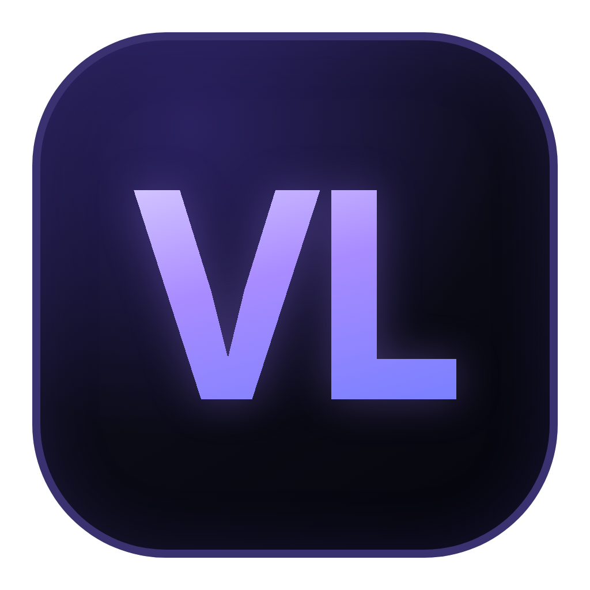
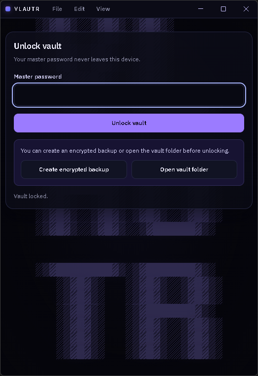
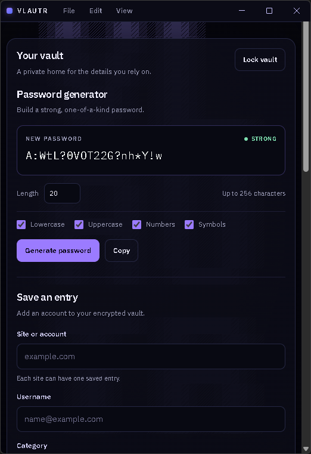
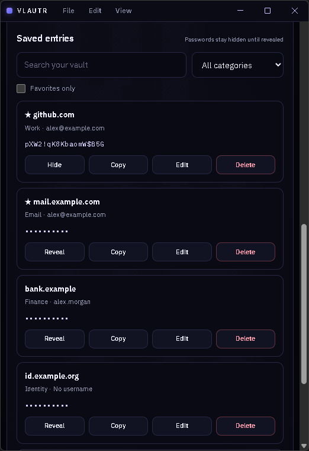
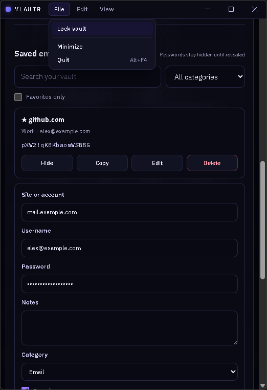

<p align="center">
  
</p>

# VLAUTR

**A local-first password generator and encrypted password vault for Windows.**


VLAUTR keeps your credentials on your own machine. Everything is encrypted with a key derived from your master password, nothing is sent over the network, and the master password is never written to disk.

> VLAUTR is the project's official name.

## Screenshots

| Unlock | Password generator |
| :---: | :---: |
|  |  |
| **Saved entries** | **Editing an entry and the File menu** |
|  |  |

<sub>Screenshots use sample data in a throwaway vault.</sub>

## Features

**Password generator**
- Length from 1 to 256 characters, with lowercase, uppercase, number, and symbol sets.
- Uses the Web Crypto random source with unbiased sampling, and guarantees at least one character from every selected set.
- Live strength rating (Weak / Fair / Strong) based on estimated entropy.

**Encrypted vault**
- Create a vault protected by a master password (8 to 1024 characters).
- Change the master password from the File menu. An encrypted backup is saved first, and older backups keep needing the old password.
- Store site, username, password, notes, category, and favorite status for each entry.
- Paste an entry's backup codes in any layout. Each code gets its own checkbox, so you can track which ones are used.
- Edit and delete entries; duplicate sites are rejected.
- Import passwords from a CSV file and export your vault to CSV, both from the File menu (see [Importing and exporting](#importing-and-exporting-csv)).
- Search across sites, usernames, notes, and categories, and filter by category or favorites. Favorites are listed first.

**Safety by default**
- Passwords stay hidden until you reveal them.
- Copying needs a confirmation, and the clipboard is cleared after 10 seconds if it still holds the copied password.
- The vault locks manually, from the File menu, after five minutes of inactivity, and when the window closes.
- Create an encrypted backup or open the vault folder from the unlock screen, even before unlocking.
- Older vault formats are upgraded automatically, with a backup taken before anything is rewritten.

**Interface**
- A dark, purple-accented design with IBM Plex Sans and IBM Plex Mono, bundled locally.
- A custom title bar with File, Edit, and View menus that match the app's theme.

## Security model

| | |
| --- | --- |
| Key derivation | PBKDF2-HMAC-SHA256, 600,000 iterations, 16-byte random salt |
| Encryption | AES-256-GCM with a fresh 12-byte IV on every write |
| Storage | A single `vault.json` file in the app's user-data folder |
| Process isolation | Encryption and file access run only in Electron's main process. The interface runs sandboxed, with context isolation and no Node.js access, and talks to the main process through a small, validated IPC API. |
| Network | None. The page's Content Security Policy only allows local resources. |

The clipboard is shared with other apps and with Windows clipboard history, so treat copying as a convenience, not secure storage.

See [docs/SECURITY.md](docs/SECURITY.md) for the full threat model and known gaps.

## Getting started

### Requirements

- Windows 10 or 11
- [Node.js](https://nodejs.org) with npm (developed with Node.js 24 and npm 12)

### Run from source

```sh
npm ci
npm start
```

Only one copy of the app can run at a time. Starting it again brings the open window to the front.

### Build for release

```sh
npm run dist
```

This writes two files to the `dist` folder:

- `VLAUTR Setup <version>.exe`: an installer that adds VLAUTR to your user account, with Start menu and desktop shortcuts and an uninstaller. It doesn't need administrator rights.
- `VLAUTR <version>.exe`: a portable build that runs without installing.

To build only the installer, run `npm run dist:setup`.

Both are unsigned for now, so Windows SmartScreen may warn you before the first run.

### Run the tests

```sh
npm test
```

Tests use Node's built-in test runner and cover the vault lifecycle, migration, recovery from damaged or interrupted writes, the IPC handlers (caller checks, copy tokens, clipboard clearing, auto-lock, permissions), backup codes, and CSV import and export. See [docs/PHASE-0-BASELINE.md](docs/PHASE-0-BASELINE.md) for coverage, packaging checks, and performance numbers.

## Importing and exporting (CSV)

Both are in the **File** menu next to **Lock vault**, and both need the vault to be unlocked.

- **Import CSV...** reads exports from Chrome, Edge, Brave, Firefox, Bitwarden, 1Password, LastPass, KeePass, Dashlane and Apple Passwords. Rows without a password are skipped and listed by row number. Entries already in the vault are skipped, and a second account on a site you already have is saved as `site (username)`. An encrypted backup of your vault is made before anything is added, and you can choose to delete the CSV afterwards (a plain delete, not a secure wipe).
- **Export CSV...** writes every entry to a CSV you choose, with the columns `name, url, username, password, note, category, favorite, backup_codes` (backup codes already marked as used are left out). **The file is not encrypted.** VLAUTR asks you to confirm first, warns if the folder looks cloud-synced (OneDrive, Dropbox, Google Drive, iCloud), and reminds you to delete the file when you are done. Import it into your other password manager instead of opening it in Excel.

## Where your data lives

The vault is stored at `%APPDATA%\my-projects\vault.json`. `npm start`, the installed app, and the portable build all use this same file. Uninstalling VLAUTR leaves this folder in place, so your vault and backups are kept. Backups are saved next to it:

- `vault-backup-<timestamp>-<id>.bak`: backups you create with "Create encrypted backup" or "Create backup now".
- `vault-before-password-change-<timestamp>-<id>.bak`: made automatically before the master password is changed.
- `vault-before-import-<timestamp>-<id>.bak`: made automatically before a CSV import.
- `vault-before-restore-<timestamp>-<id>.bak`: your vault as it was just before a restore.
- `vault.json.v<version>-<timestamp>-<id>.bak`: automatic backups taken before a format upgrade.

Backups are exact copies of the encrypted vault and open with the master password that was in use when they were made. **File > Backups…** lists them with their date, kind, size and whether they look intact, and **Restore…** opens one with its password, shows how many entries it holds, and can then restore it after a confirmation. Your current vault is always saved first as a `vault-before-restore-*` backup, and the vault locks afterwards: unlock it with the master password that was in use when the backup was made. If the vault won't open, **Restore from backup…** on the unlock screen does the same.

## Project structure

```
main.js         Electron main process: window, app lifecycle, wiring
ipc-handlers.js IPC handlers: caller checks, vault calls, copy and clipboard clearing, auto-lock, menu actions
vault.js        PasswordVault: key derivation, encryption, validation, migration, file writes
preload.js      Exposes the window.electronAPI bridge to the interface
renderer.js     Interface logic: generator, vault entries, unlock flow, title bar menus
page.html       The single page: markup, styles, and Content Security Policy
csv-transfer.js The single JS file for importing, exporting, and lastly handling CSV files
csv-ui.js       File menu items and the results window (csv-ui.css holds its styles)
test/           Tests for the vault, IPC handlers, backup codes and CSV (node --test)
docs/           Screenshots and project documentation
```

## Roadmap

Development is planned in phases:

| Phase | Focus |
| --- | --- |
| 0. Stabilization | Packaging checks, broader tests, recovery scenarios, threat model |
| 1. Security foundation | Less plaintext in the interface, ID-based copy, safer writes, master-password change |
| 2. Vault management | Backup manager and restore, password history, secure notes, CSV import and export that work with browsers and other password managers |
| 3. Password intelligence | Password health, weak and reused password detection, passphrases |
| 4. Application experience | Dashboard, custom categories, shortcuts, onboarding, accessibility |
| 5. Multi-device | Optional end-to-end encrypted sync |
| 6. Platform expansion | Browser extension, Windows Hello, mobile |

## Built with

- [Electron](https://www.electronjs.org/)
- HTML, CSS, and JavaScript with no front-end framework
- [IBM Plex](https://github.com/IBM/plex) via [Fontsource](https://fontsource.org/)

## License

ISC, as declared in `package.json`.
